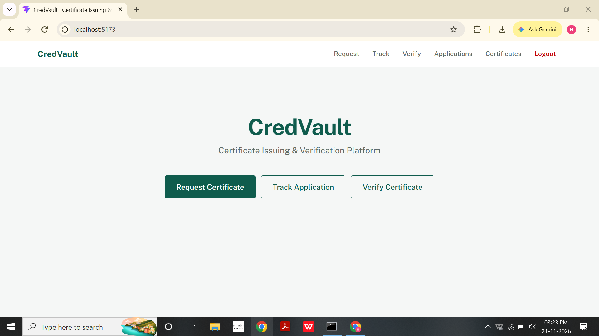
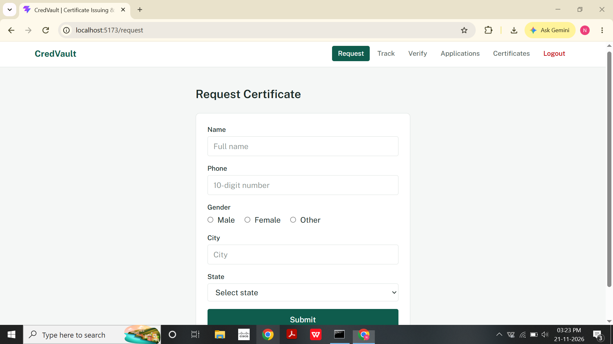
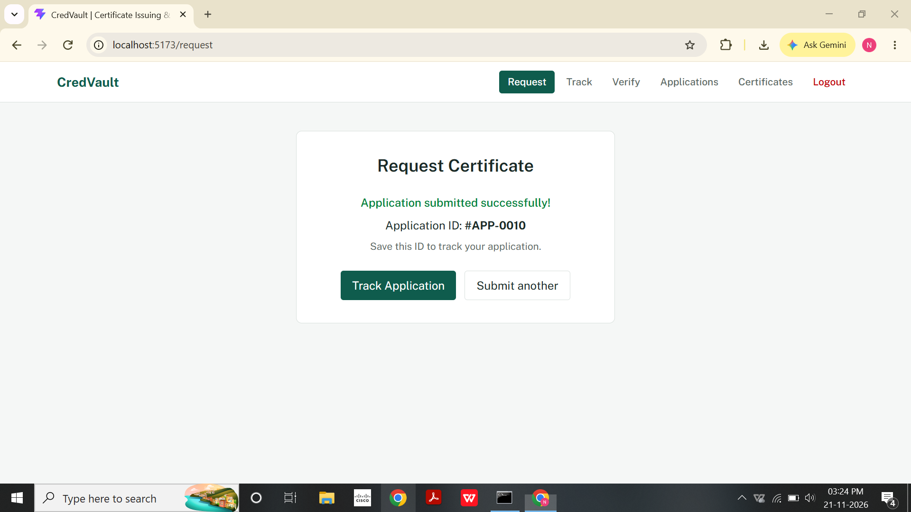
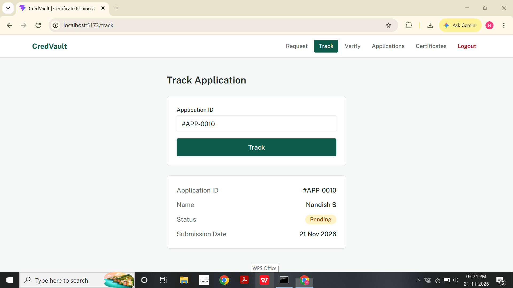
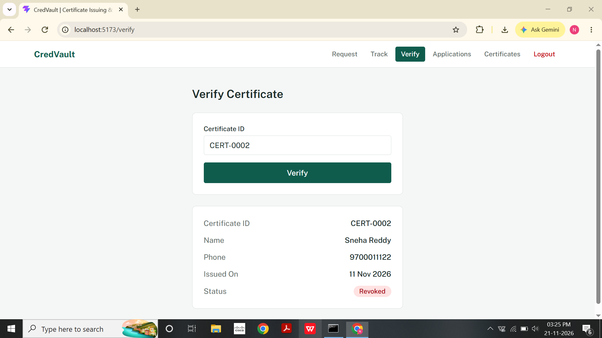
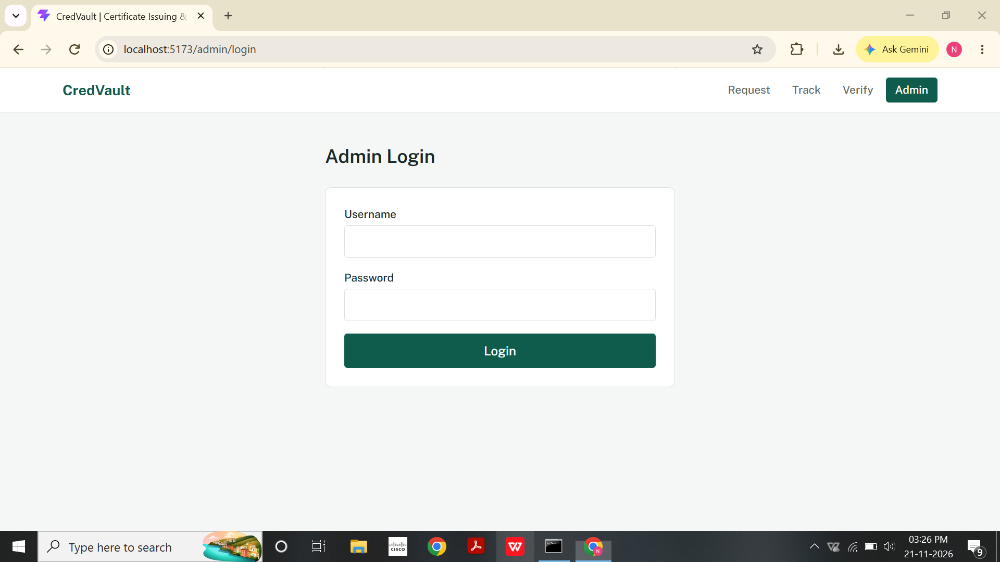
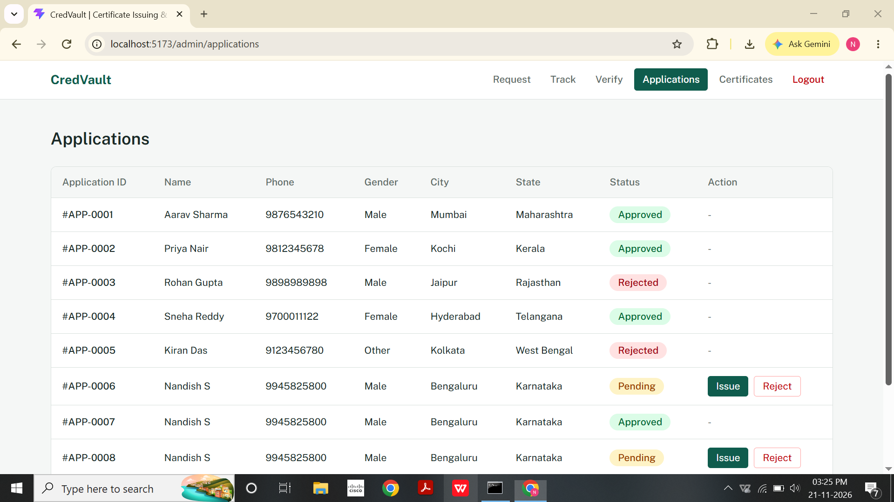
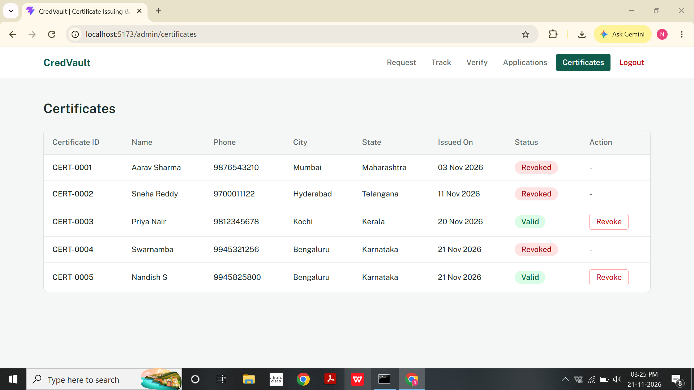

# CredVault - Certificate Issuing & Verification Platform

Frontend prototype for **ELEVATE SDE Internship - Task 2**.

CredVault lets citizens request a certificate, track their application and verify a certificate, while admins review applications and manage issued certificates. All data is dummy data stored in the browser, so no backend is needed yet. The code is structured so a backend can be connected in the next task.

## Features

**Citizens / public**
- Request a certificate with a validated form (name, phone, gender, city, state)
- Get an Application ID after submitting (e.g. `#APP-0006`)
- Track an application by ID: name, status and submission date
- Verify a certificate by ID: name, phone, issue date and status (Valid / Revoked / Not Found)

**Admin**
- Login page (dummy credentials)
- Applications table with **Issue** and **Reject** actions
- Certificates table with a **Revoke** action
- Admin pages are protected: logged-out visitors are redirected to login

**General**
- Basic form validation for empty fields, plus a 10-digit phone check
- Case-insensitive ID lookup (`app-0001`, `#APP-0001`)
- Responsive layout; tables scroll sideways on small screens
- Data is shared across pages and saved in `localStorage`, so the whole flow works end to end

## Tech Stack

- React 19 + Vite
- React Router
- Tailwind CSS
- Context API + `localStorage` for dummy data

## Pages

| Route | Page |
|---|---|
| `/` | Home |
| `/request` | Request Certificate |
| `/track` | Track Application |
| `/verify` | Verify Certificate |
| `/admin/login` | Admin Login |
| `/admin/applications` | Admin: Applications |
| `/admin/certificates` | Admin: Certificates |

## Getting Started

Requires [Node.js](https://nodejs.org/) (LTS).

```bash
git clone https://github.com/Nandish2005-maker/ELEVATE-SDE-Task-2.git
cd ELEVATE-SDE-Task-2
npm install
npm run dev
```

Open the local address shown in the terminal (usually `http://localhost:5173`).

## Demo Data

- **Admin login:** username `admin`, password `admin`
- **Sample Application IDs:** `#APP-0001` (Approved), `#APP-0002` (Pending), `#APP-0003` (Rejected)
- **Sample Certificate IDs:** `CERT-0001` (Valid), `CERT-0002` (Revoked)

To reset the demo data, clear the site's Local Storage in your browser's developer tools and refresh.

**Try the full flow:** submit a request, log in as admin, click Issue on it, then verify the new certificate ID. Revoke it and verify again.

## Project Structure

```
src/
  components/   Navbar, FormInput, StatusBadge, ProtectedRoute
  context/      DataContext (applications and certificates), AuthContext (admin login)
  data/         dummyData.js, states.js
  pages/        Home, Request, Track, Verify, AdminLogin, AdminApplications, AdminCertificates
  utils/        formatDate.js
  App.jsx       Routes
  main.jsx      Entry point and providers
```

All data access goes through `DataContext`, so connecting a backend only means replacing those functions with API calls.

## Screenshots

### Home


### Request Certificate


### Application Submitted


### Track Application


### Verify Certificate


### Admin Login


### Admin: Applications


### Admin: Certificates


## Author

Nandish S
